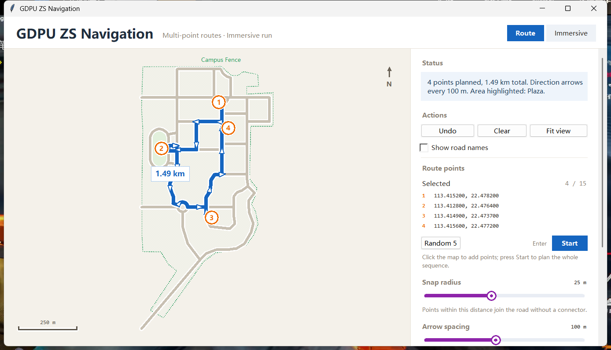

# campus-nav

A desktop demo for **GDPU ZS** navigation. It is built with Python and tkinter,
loads campus road and fence GeoJSON data, and lets you plan multi-point routes
on the map, inspect distances, and watch an immersive scoring run with a live
green trajectory and pace playback.

The UI uses GCJ-02 coordinates throughout.

## Interface preview

Route planning mode: numbered points, the planned route, and direction arrows.



## Features

The window has two modes.

### Route planning

- **Multi-point planning**: left-click the map to add ordered points (2 to 15
  points; Undo removes the last one, Clear removes all). Press the **Start**
  button or the **Enter** key to plan the whole sequence with Dijkstra. Every
  point is projected orthogonally onto its nearest road; a point farther than
  the snap radius gets an orange dashed connector, while a point within it
  joins the road directly with no connector and no extra distance.
- **Random 5**: generates five ordered road points, plans them immediately, and
  fits the view. Custom points can be added on top of that sequence.
- **Snap radius**: a slider from 0 to 60 m (default 25 m) controls how close a
  point must be to count as already on the road.
- **Direction arrows**: route planning has no playback. Instead, white
  direction arrows repeat along the planned route at a spacing chosen with a
  slider from 20 to 200 m (default 100 m).
- **Distance breakdown**: the sidebar lists the distance of each leg
  (1 -> 2, 2 -> 3, ...) plus the total.

### Immersive simulation

- **Live playback**: pick a start point on the map (not a checkpoint). The app
  connects it to the nearest road and reveals checkpoint 1; each further
  checkpoint is generated only after the current one is reached. The planned
  route is deliberately **not drawn**, so the green line shows only the
  real-time trajectory actually covered; the moving pace arrow marks the
  current position.
- **Gate roads**: features carrying `random_exclude: true` are never used when
  checkpoints are generated. Only the gate-side stretch is marked: the road
  from West Gate 2 is split at West Avenue, so its inner half stays eligible.
  Picking any road by hand in route planning still works.
- **Pace**: a slider from 0'05'' to 10'00'' per kilometer (default 5'00'').
  Press Play/Pause; the large readout is the **distance already walked from the
  start**, while the small line keeps the total.
- **Reduce backtracking**: avoids an immediate 180-degree reversal at a
  checkpoint by excluding the reverse of the last edge; if that leaves no
  route, the exclusion is dropped automatically.
- **Daily cap extension**: after the five checkpoints, the route heads for the
  running track and continues counterclockwise until the daily cap is reached
  (8 km for male, 5 km for female, male by default).
- **Stroll**: every road and ring is treated as a centerline with a uniform
  10 m width. The moving arrow keeps to the right side, may wander inside that
  lane, and returns to the centerline at checkpoints. Corners are followed as
  rounded arcs instead of stepping on the raw GeoJSON vertices, the lane is
  pulled toward the inside of a turn so the trail never folds over itself, and
  a checkpoint that requires doubling back is reached with a half-circle loop
  rather than an acute angle. The location interval (1-10 s) and maximum
  heading noise (0 to +/-5 degrees) are adjustable. The full wander path is
  generated before playback starts, so the arrow never pauses to search for
  the next target.

### Both modes

- **Polygon semantics**:
  - `traverse: "area"`: the interior is freely traversable and the whole area
    is highlighted when crossed.
  - `traverse: "ring"`: traffic is allowed only along the boundary ring.
  - `run_direction: "ccw" / "cw"`: the ring is one-way in the given direction
    (the running track is counterclockwise).
- **Campus fence**: loads the electronic fence supplied by the server
  (`traverse: "fence"`) and draws it at the bottom of the map with a pale
  green fill and a green dashed boundary. The initial view fits the roads and
  the fence together.
- **Map interaction**: click inside the fence to add or pick points; left-drag
  outside the fence to pan the map. The wider right sidebar scrolls vertically
  when its options exceed the window height. The mouse wheel scrolls the
  sidebar and never changes a slider value.

## Requirements

- Python >= 3.10 (the standard-library `tkinter` module is required)
- [uv](https://docs.astral.sh/uv/)

## Quick start

```bash
cd campus-nav
uv sync
uv run campus-nav
```

Other entry points:

```bash
uv run python -m campus_nav          # equivalent entry point
uv run campus-nav --check            # run road/algorithm checks only, no window
uv run campus-nav --map other.geojson
uv run campus-nav --fence other_fence.geojson
uv run campus-nav --demo 113.41518,22.47824,113.41333,22.47436
```

`uv sync` creates `.venv/`, installs the project itself, and generates
`uv.lock`. For day-to-day work, run everything through `uv run ...`; activating
the virtual environment manually is unnecessary.

## Project layout

```text
campus-nav/
├── pyproject.toml
├── uv.lock
├── README.md
├── docs/
│   └── route.png                # route-planning preview
├── scripts/
│   └── build_gcj02_data.py      # WGS-84 roads / BD-09 fence -> GCJ-02
├── src/
│   └── campus_nav/
│       ├── __init__.py
│       ├── __main__.py          # python -m campus_nav
│       ├── cli.py               # CLI / --map / --fence / --check / --demo
│       ├── config.py            # package paths, default map and fence
│       ├── checks.py            # --check self-test (49 items)
│       ├── formatting.py        # distance and longitude/latitude formatting
│       ├── pacing.py            # pace parsing and formatting
│       ├── data/
│       │   ├── map_wgs84.geojson    # road source data (WGS-84)
│       │   ├── map_gcj02.geojson    # default map for the UI (GCJ-02)
│       │   ├── fence_bd09.geojson   # server fence source data (BD-09)
│       │   └── fence_gcj02.geojson  # default fence for the UI (GCJ-02)
│       ├── geo/
│       │   ├── projection.py    # longitude/latitude -> local metric plane
│       │   ├── datum.py         # WGS-84 / BD-09 -> GCJ-02
│       │   ├── fence.py         # fence GeoJSON loader
│       │   ├── polygons.py      # point/segment vs. polygon tests
│       │   └── paths.py         # polyline midpoint, interpolation, stitching
│       ├── routing/
│       │   ├── models.py        # Edge / Area / RouteResult / PointRun
│       │   ├── dijkstra.py      # Dijkstra with forbidden-direction support
│       │   ├── campus_map.py    # graph construction, routing, run planning
│       │   ├── immersive.py     # immersive state machine (one-by-one reveal)
│       │   └── stroll.py        # playback-only wander path (right side, 10 m lane)
│       └── ui/
│           ├── app.py           # main window, interaction, sidebar, playback
│           ├── widgets.py       # integer value slider (rheostat style)
│           ├── drawing.py       # canvas viewport and drawing
│           ├── dpi.py           # Windows high-DPI support
│           └── theme.py         # colors and fonts
└── tests/
    ├── conftest.py
    ├── test_pacing.py
    ├── test_geo.py
    ├── test_datum.py
    ├── test_fence.py
    ├── test_routing.py
    ├── test_immersive.py
    ├── test_stroll.py
    ├── test_formatting.py
    └── test_cli.py
```

## Map data

The GUI loads `src/campus_nav/data/map_gcj02.geojson` and
`src/campus_nav/data/fence_gcj02.geojson` by default; both are shipped with the
package. Use `--map` / `--fence` to point at other files. Coordinates are
**GCJ-02** longitude/latitude. Feature attributes are:

| Attribute | Meaning |
| --- | --- |
| `desc` | Road/area display name, used in the sidebar and road labels |
| `traverse` | `area` = freely traversable interior; `ring` = boundary only; `fence` = display-only fence |
| `run_direction` | `ccw` / `cw`, only for `ring`, sets the one-way direction |
| `random_exclude` | `true` = excluded from generated checkpoints (gate-side stretches) |

Source data is kept under `data/`: roads are WGS-84 (`map_wgs84.geojson`) and
the server fence is exported from its `lat/lng` fields as BD-09
(`fence_bd09.geojson`). After editing a source file, regenerate the GCJ-02
files:

```bash
uv run python scripts/build_gcj02_data.py
```

## Algorithm notes

1. Build a local equirectangular projection around the center point and convert
   longitude/latitude to meters. Before projection, `geo/datum.py` normalizes
   the datum (roads from WGS-84, fence from BD-09).
2. Merge duplicate vertices within a tolerance and build an undirected graph
   from all lines and rings; rings with `run_direction` get one-way edges.
3. When planning, project each selected point onto the nearest road, split the
   original edge by inserting virtual nodes, and chain the legs in order. When
   the projection distance is within the snap radius, no connector is added to
   the distance or drawn.
4. For `area` polygons, precompute visibility chords between boundary vertices
   so the router can cross the interior and record the whole area for
   highlighting.
5. Run Dijkstra from C to D. Reduce backtracking forbids the reverse of the
   edge just traversed during the search.
6. For the daily cap extension, the track entrance acts as a hidden sixth
   point: route to the track, then continue along the counterclockwise
   boundary for the remaining distance (multiple laps are allowed) and
   truncate the final path by length.
7. Stroll playback treats the planned route as a centerline. Each leg between
   U-turns is resampled and smoothed into a curve, so corners become short
   arcs and the path never steps on the raw GeoJSON vertices. Each location
   update still advances by `speed x interval` meters with a bounded random
   heading; the offset stays in the right half of the 10 m road, is capped on
   the inside of a turn in proportion to the local corner radius (which is
   what keeps the trail from folding back on itself), and returns to the
   centerline at checkpoints. Where the route doubles back, a half circle joins
   the two lanes so the required turn-around is a loop instead of an acute
   angle. The sequence is precomputed; the animation only interpolates it.
8. Route-planning direction arrows are sampled every N meters along the
   planned polyline, taking the unit tangent of the segment they fall on. The
   sampler is independent of the graph, so arrow density can change without
   replanning.

## Development and testing

```bash
uv sync
uv run pytest
uv run campus-nav --check
```

`test_self_check_passes` in `uv run pytest` runs the same 54 checks as
`--check`. The remaining tests cover pace parsing, datum conversion, fence
alignment, stroll-path smoothness and bounds, arrow sampling, snap radius,
live-trail playback, geometry helpers, routing, and scoring-run behavior.
